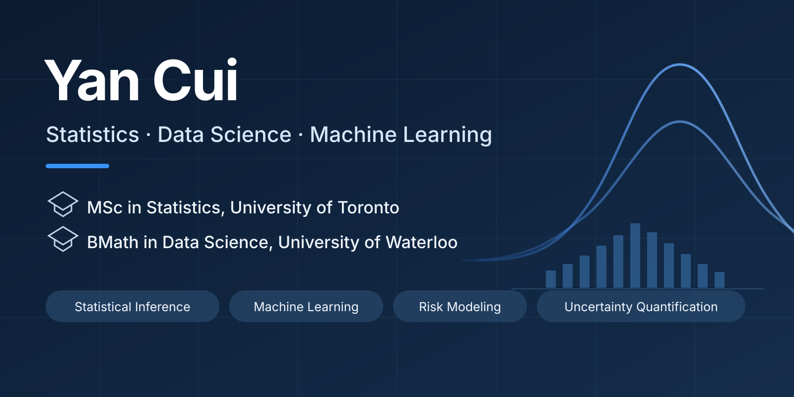

  

<h2 align="center">Yan Cui</h2>

  <strong>MSc Statistics · University of Toronto</strong> 
  <strong>BMath Data Science | Statistics & Computer Science · University of Waterloo</strong>

  <strong>Statistics · Computer Science · Machine Learning</strong> 
  Statistical Inference · Model Evaluation · Risk Modeling · Uncertainty Quantification

---

### About

I am a Statistics graduate student at the University of Toronto with an undergraduate background in Data Science from the University of Waterloo. My academic interests sit at the intersection of statistical methodology and computer science, particularly statistical inference, machine learning, model evaluation, and methods for quantifying uncertainty in data-driven decisions.

### Selected Projects

| Project | Focus |
|---|---|
| [Satellite Anomaly Detection](https://github.com/Y237cui/satellite-anomaly-detection-research) | Time-series anomaly detection and event-level model evaluation |
| [Toronto Home-Price Analysis](https://github.com/Y237cui/toronto-home-price-analysis) | Predictive modeling, error analysis, and statistical evaluation |
| [Data Pipeline Engineering](https://github.com/Y237cui/donkin-data-pipeline-showcase) | Python, asynchronous data ingestion, PostgreSQL, and data quality |
| [NBA Career Analytics](https://github.com/Y237cui/nba-career-analytics-r-shiny) | R Shiny, interactive visualization, and data analysis |

### Technical Skills

- **Programming:** Python, SQL, R, C/C++, Java
- **Machine Learning & AI:** scikit-learn, PyTorch, anomaly detection, model evaluation, statistical learning
- **Data Engineering:** PostgreSQL, MySQL, MongoDB, Kafka, Docker, PySpark, Hadoop, REST APIs, FastAPI
- **Cloud & Tools:** AWS, Git, Linux, HPC, Jupyter, Bash

---

  Thanks for visiting my profile.

